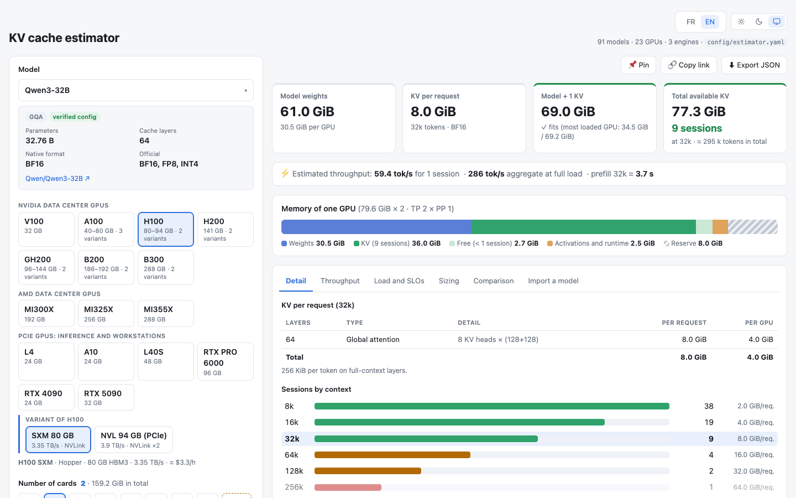
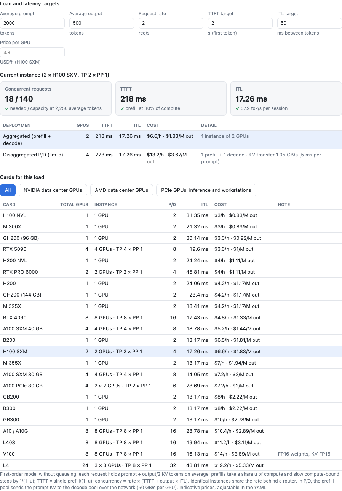
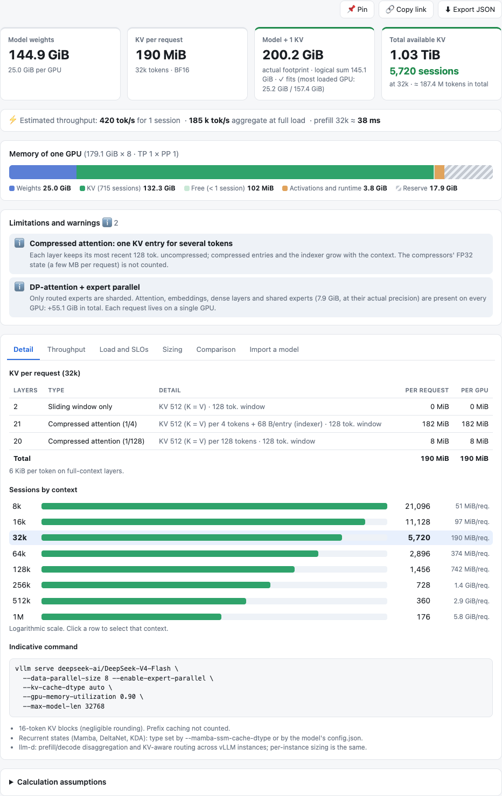
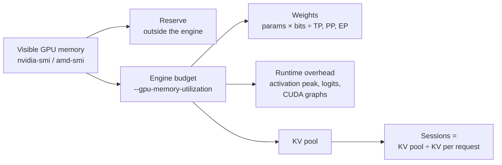

# KV cache estimator

**How much GPU memory, how many GPUs and what budget to serve an open-weight LLM.** Weights, KV cache, runtime overhead, throughput and latency-target sizing for vLLM / llm-d, SGLang and ZML / LLMD, on 23 NVIDIA and AMD GPUs and 91 models.



French and English interface · light, dark or system theme · shareable URLs · JSON API and CLI · no GPU needed to run it.

## What it answers

| Question | Where |
|---|---|
| Does the model fit? How much KV cache per request, how many concurrent sessions? | Indicators, memory bar, **Detail** tab |
| How fast? Tokens per second per session, in aggregate and per GPU; prefill time | **Throughput** tab |
| How many GPUs for N requests per second within TTFT and ITL targets, at what cost? Aggregated or prefill/decode disaggregated (llm-d)? | **Load and SLOs** tab |
| Fewest GPUs of each type for N sessions; longest context for N sessions | **Sizing** tab |
| Which of several setups is best? | **Comparison** tab (up to six pinned scenarios) |
| What about a model that is not in the list? | **Import a model** tab, by Hugging Face repository |

| Load and SLOs | Unusual attention layouts (DeepSeek V4, 8 × B200, DP-attention) |
|---|---|
|  |  |

## Quick start

Node.js 22.13 or newer with Corepack (`package.json` pins pnpm):

```bash
corepack enable && pnpm install --frozen-lockfile
pnpm run dev                          # http://localhost:3000
pnpm run build && pnpm start          # production
```

Or the image of the latest release (`linux/amd64` and `linux/arm64`; features merged since then arrive with the next release):

```bash
docker run --rm -p 3000:3000 ghcr.io/guillaume-lombardo/kv-cache-estimator:latest
```

Mounting your own catalogue, serving under a URL prefix such as `/kv-estimator`, health checks, Traefik and releases are covered in [docs/deployment.md](docs/deployment.md).

## API and CLI

Every scenario is a URL. The same parameters return the full JSON report, with every issue carrying a stable `code`:

```bash
curl 'http://localhost:3000/api/estimate?model=qwen3-32b&gpu=h100&n=2&ctx=65536&rps=4&lang=en'
pnpm run estimate model=qwen3-32b gpu=h100 n=2 ctx=65536 rps=4    # same report, offline
```

| Parameter | Meaning | Parameter | Meaning |
|---|---|---|---|
| `model`, `gpu`, `eng` | Catalogue identifiers | `in`, `out` | Average prompt and output tokens |
| `n`, `tp`, `mode` | GPU count, TP degree (PP = n / TP), `tp-pp` or `dp-ep` | `rps` | Requests per second |
| `w`, `kv` | Weight and KV cache formats | `ttft`, `itl` | Targets: seconds to first token, ms between tokens |
| `ctx` | Context length in tokens | `usd` | Price per GPU-hour |
| `r` | Reserve outside the engine, % | `mbt`, `ovh` | Tokens per scheduling step, measured overhead in GiB |
| `mem`, `off` | Visible GiB per GPU, CPU offload GiB per GPU | `lang` | `fr` or `en` |

Unknown identifiers return HTTP 400 (exit code 2 for the CLI).

## How it works

Each GPU's memory is split the way the engine splits it. Sessions are whatever KV fits in the rest:



vLLM pays the runtime overhead from its budget. SGLang's `--mem-fraction-static` covers weights and KV only, so the overhead must fit in the reserve.

KV per request follows each model's attention layout:

| Layers | KV per token and layer |
|---|---|
| GQA / MHA | KV heads × (K dim + V dim) × bytes |
| Sliding window | Same, capped at the window when the engine frees expired blocks |
| MLA (DeepSeek, Kimi, GLM) | (latent rank + RoPE dim) × bytes, plus sparse-indexer keys |
| Compressed (DeepSeek V4) | One shared K = V entry per `compressRatio` tokens, plus a raw window |
| Linear / SSM (Mamba, DeltaNet) | Constant state per request, whatever the context |

Parallelism changes where it lands. TP shards KV heads and replicates them beyond their count, and replicates MLA latents. PP sizes the most loaded stage. DP-attention keeps each request on one GPU and shards only routed experts.

The workload model is first order. Each request holds its prompt plus half its output in KV on average. Prefills take a share of compute and slow decoding. Little's law gives the concurrency, then replicas share the traffic. Formulas, engine profiles and assumptions are in [docs/calculation.md](docs/calculation.md).

## Hardware, engines and models

| Group | GPUs |
|---|---|
| NVIDIA data center | V100 · A100 (SXM 40/80 GB, PCIe 80 GB) · H100 (SXM, NVL) · H200 (SXM, NVL) · GH200 (96/144 GB) · B200 (HGX, GB200 NVL72) · B300 (HGX, GB300 NVL72) |
| AMD data center | MI300X · MI325X · MI355X |
| PCIe: inference and workstations | L4 · A10 / A10G · L40S · RTX PRO 6000 · RTX 4090 · RTX 5090 |

In the interface, pick a family in one of these groups, then a variant (memory size, form factor, rack).

| Engine | Profile |
|---|---|
| vLLM / llm-d | Reference: memory accounting and defaults from vLLM v0.32 source |
| SGLang | 0.5.22 documentation and source, partially verified |
| ZML / LLMD | LLMD documentation and ZML library code, partially verified |

**Formats:** BF16, FP16, FP8, INT8, INT4, MXFP4 and NVFP4 weights; BF16, FP16, FP8 and NVFP4 KV cache. A format needs both the GPU and the engine; limited or unverified ones carry a warning.

**Models:** 91 open-weight models from Mistral, Qwen, DeepSeek, Kimi, GLM, MiMo, Gemma, Llama, NVIDIA and more. Add one from Hugging Face in the UI, or with `pnpm run import-model --hf org/name --append`. Set `HF_TOKEN` for gated repositories.

Everything lives in `config/estimator.yaml`, read at startup. Point `KV_ESTIMATOR_CONFIG` at another YAML or JSON file to replace it without rebuilding. Run `pnpm run check-config` to validate a file. Schema and import details are in [docs/catalogue.md](docs/catalogue.md).

## Limits

These are capacity and first-order performance estimates, not benchmarks. Validate a model, engine and hardware combination before relying on it for production. Not modelled:

- prefix-cache reuse, speculative decoding and LoRA adapters;
- encoder activations for vision and audio models;
- queueing before prefill, and network latency between prefill and decode pools.

## Development

```bash
pnpm run check-config && pnpm run typecheck && pnpm test && pnpm run build
```

CI runs the same checks, then builds and smoke-tests the container at the root and under `/kv-estimator`.

Write documentation, comments and docstrings in English. Do not edit the snapshots in `config/upstream/`, which are copies of external `config.json` files. Every UI string and catalogue message exists in French and English: `t("…", "…")` in components, `tr(lang)` in `src/lib`, `{ fr, en }` in the catalogue.
